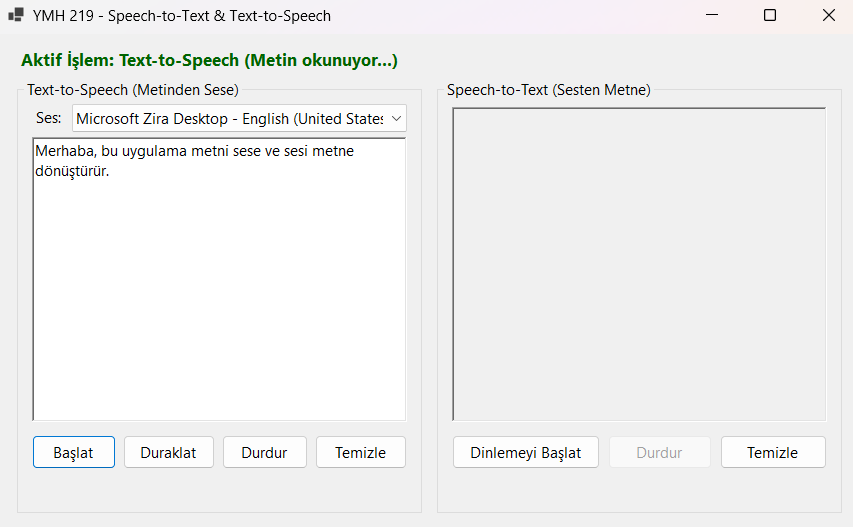
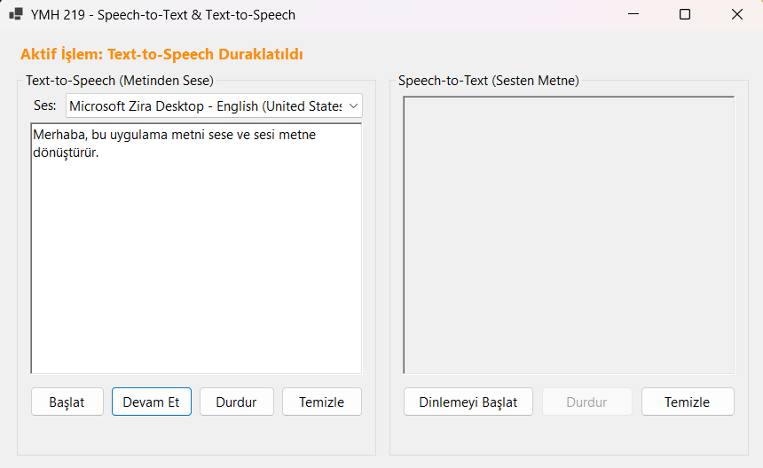
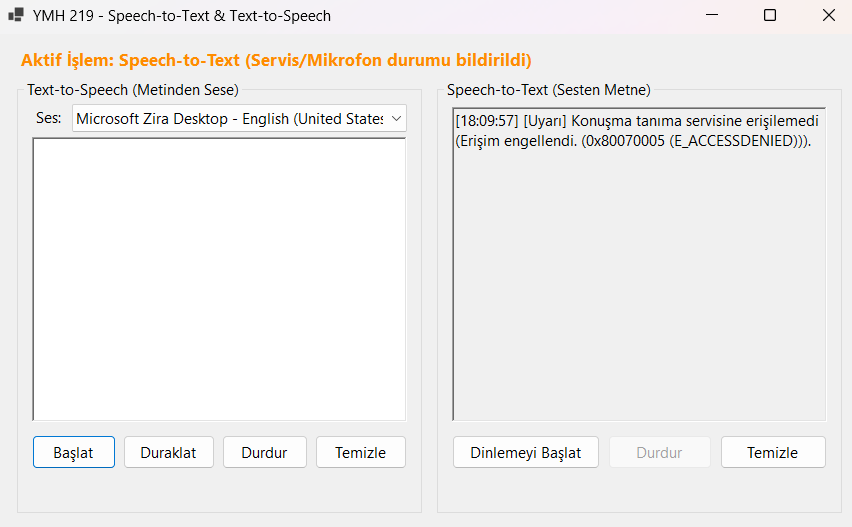

# YMH219 - Speech-to-Text ve Text-to-Speech Uygulaması

C# ve .NET Windows Forms kullanılarak geliştirilmiş, metni sesli okutan (Text-to-Speech) ve mikrofon/konuşma tanıma servisi üzerinden ses-metin dönüşümü ve durum/hata yönetimi sunan masaüstü uygulaması. Nesne Tabanlı Programlama (YMH 219) uygulama ödevi kapsamında hazırlanmıştır.

## Kullanılan Teknolojiler
- C#
- .NET (`net10.0-windows`, Windows Forms)
- Windows SAPI (COM)
- Visual Studio

## Kurulum ve Çalıştırma
1. Repoyu klonla: `git clone https://github.com/saryaasu/YMH219-SpeechApp.git`
2. Proje dosyasını (`.csproj` veya `.sln` / `.slnx`) Visual Studio ile aç
3. **F5** ile derleyip çalıştır

## Uygulama Kontrolleri ve Özellikleri
- **Text-to-Speech:** Girilen metni sesli okutma; **Başlat**, **Duraklat / Devam Et**, **Durdur** ve **Temizle** işlevleri ile ses seçimi
- **Speech-to-Text:** **Dinlemeyi Başlat**, **Durdur** ve **Temizle** işlevleri; mikrofon veya konuşma tanıma servisine erişilemediğinde kullanıcıya anlaşılır hata/durum bildirimi
- **Aktif İşlem Göstergesi:** O an hangi işlemin aktif veya duraklatılmış/uyarı durumunda olduğunu arayüzde açıkça belirtme
- **Nesne Tabanlı Yapı:** Konuşma motoru ve kaynak yönetimi `SpeechEngineService` (`IDisposable`), `SesBilgisi` ve `Form1` sınıfları üzerinden düzenlenmiştir

## Ekran Görüntüleri

### Text-to-Speech Başlatma

### Text-to-Speech Duraklatma

### Speech-to-Text Durum Göstergesi

## Bilinen Sınırlamalar / Geliştirme Notları
- Sistemde kurulu konuşma tanıma dil paketi veya aktif mikrofon izni bulunmadığında Speech-to-Text tarafı kullanıcıyı durum/uyarı mesajıyla bilgilendirir
- Dönüştürülen metni `.txt` dosyasına kaydetme veya ses hızı ayarı henüz eklenmedi

## Öğrenci
Sarya Su Toğyıldız - 250542024